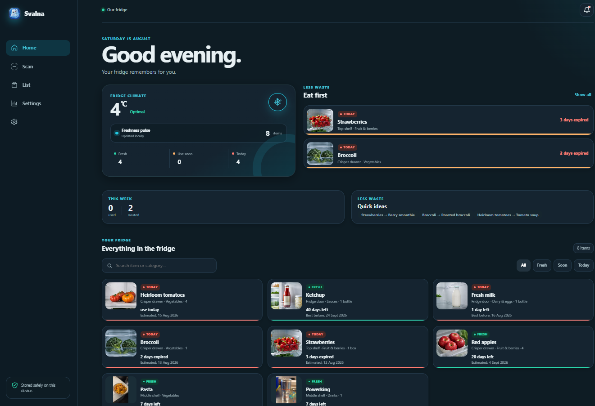
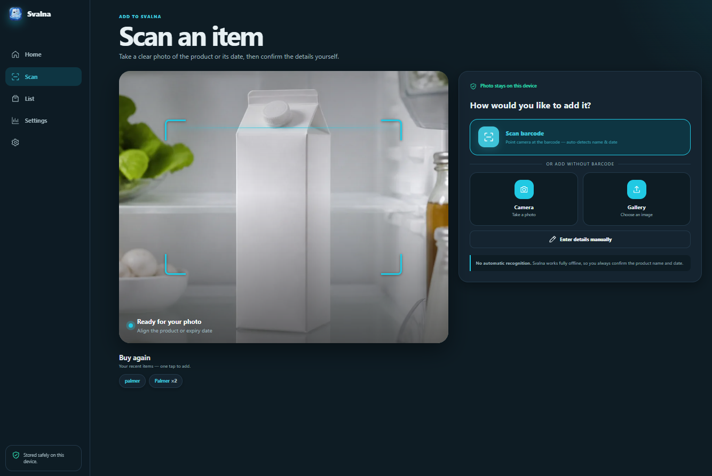
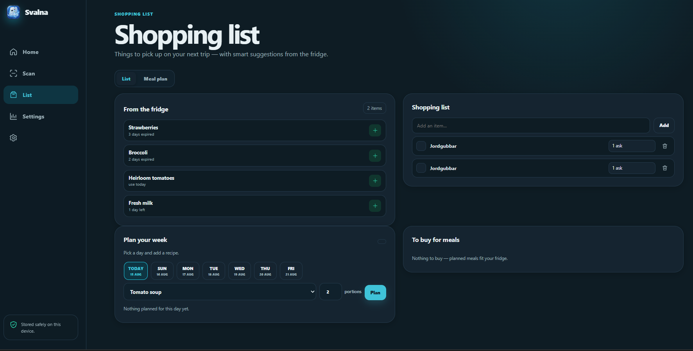
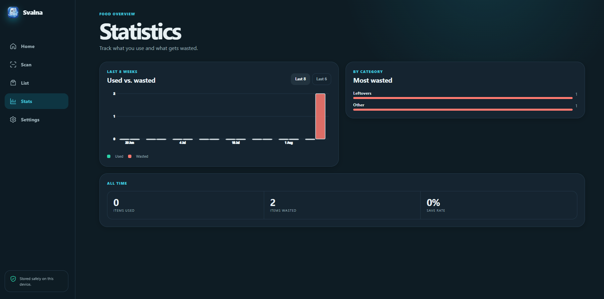
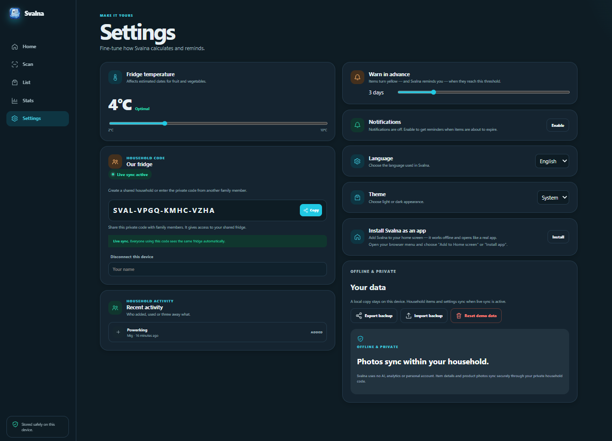

# Svalna

**Your fridge remembers for you — privately and offline.**

Svalna is a progressive web app (PWA) that helps households track fridge contents, reduce food waste, and stay organised. Everything runs locally on the device. No account, no analytics, no server required — with optional live sync via a private household code.



---

## Features

### Fridge inventory
- Add items manually, by photo, or by scanning a barcode
- Supports printed best-before dates, estimated shelf life (temperature-adjusted), or no date
- Items are colour-coded: **Fresh** · **Use soon** · **Use today / Expired**
- Drag-to-move items between fridge shelves (top, middle, door, crisper drawer)
- Freshness pulse ring on the home screen gives an at-a-glance overview

### Barcode scanning
- Live camera barcode scan using the Web BarcodeDetector API and ZXing fallback
- Name and category suggestions pulled from the open [Open Food Facts](https://world.openfoodfacts.org/) database
- OCR via Tesseract.js to read best-before dates directly from a photo

### Shopping list & meal plan
- Smart shopping suggestions based on items expiring soon
- Manual shopping list with quantities and done/clear
- 7-day meal planner with recipe suggestions and automatic ingredient aggregation

### Statistics
- Bar chart of used vs. wasted items (last 8 weeks or 6 months)
- Category breakdown of most-wasted food
- All-time save rate

### Household sharing (optional live sync)
- Create a household with a private code (`SVAL-XXXX-XXXX-XXXX`)
- Share the code with family — everyone sees the same fridge in real time
- Powered by Firebase Firestore with anonymous auth; no personal data stored
- Conflict-free merge: local dirty items are preserved during remote sync

### Privacy & offline-first
- All data stored in **IndexedDB** on the device
- No AI, no user accounts, no tracking
- Works fully offline; photos never leave the device
- Export / import JSON backup at any time

### Polished UX
- 4 languages: English, Svenska, Español, Türkçe
- Light / dark / system theme
- Full onboarding flow on first launch
- Push notifications for expiring items (browser permission required)
- Installable as a PWA — works like a native app on iOS, Android and desktop
- Accessible markup, ARIA labels, keyboard navigation

---

## Screenshots

| Home | Scan | Shopping list | Stats | Settings |
|------|------|---------------|-------|----------|
|  |  |  |  |  |

---

## Tech stack

| Layer | Technology |
|---|---|
| App | Vanilla JS (IIFE, no build step) |
| Storage | IndexedDB |
| Sync | Firebase Firestore + Anonymous Auth |
| Barcode | Web BarcodeDetector API / ZXing (`zxing.js`) |
| OCR | Tesseract.js v5 (loaded on demand from CDN) |
| Product data | Open Food Facts API v2 |
| Hosting | Firebase Hosting |
| CI/CD | GitHub Actions → Firebase Hosting (auto-deploy on push to `main`) |
| Notifications | Web Push / Service Worker |

---

## Project structure

```
kylminne_app/
├── index.html          # App shell + all views (single-page)
├── app.js              # All app logic — state, rendering, features
├── cloud-sync.js       # Firebase Firestore household sync
├── styles.css          # All styles
├── sw.js               # Service worker (offline cache + push notifications)
├── manifest.webmanifest
├── assets/
│   ├── icon.svg
│   ├── icons/          # PWA icons (192, 512, maskable)
│   ├── photos/         # Default food photos (.webp)
│   └── vendor/         # Bundled Firebase compat + ZXing
├── firebase.json
├── firestore.rules
└── .github/workflows/
    └── deploy.yml      # Auto-deploy to Firebase Hosting on push to main
```

---

## Getting started

No build step required. Open `index.html` in a browser or serve with any static server.

```bash
# Using Node.js http-server (or any equivalent)
cd kylminne_app
npx http-server . -p 8080
```

Then open `http://localhost:8080`.

For full functionality (barcode scan, camera, service worker, push notifications) the app must be served over **HTTPS** or `localhost`.

---

## Deployment

The app auto-deploys to [Firebase Hosting](https://firebase.google.com/docs/hosting) when a commit is pushed to `main`, via the GitHub Actions workflow in `.github/workflows/deploy.yml`.

Manual deploy:

```bash
npm install -g firebase-tools
firebase login
firebase deploy --only hosting
```

### Required GitHub secrets

| Secret | Description |
|--------|-------------|
| `FIREBASE_SERVICE_ACCOUNT_SVALNA_NRNWORLD` | Firebase service account JSON (base64) |

---

## Firestore security rules

Rules are defined in `firestore.rules`. Households are readable and writable by any authenticated user who knows the document ID (the household code). Anonymous auth is used — no personal data is collected.

---

## License

MIT

---

☕ **Support development**: [Buy me a coffee 💜](https://ko-fi.com/nrnworld)

Created by ❤️ © nRn World
